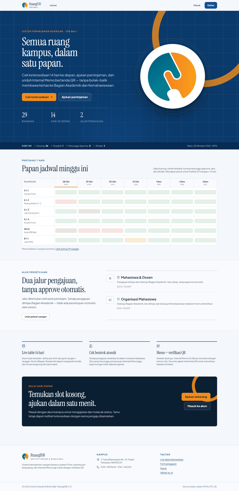
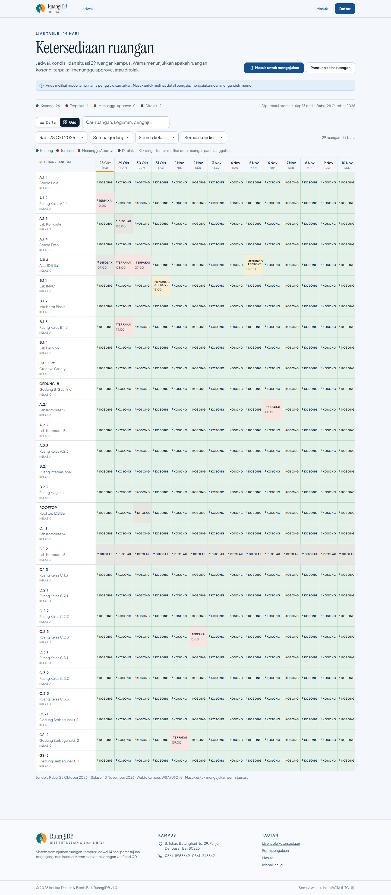
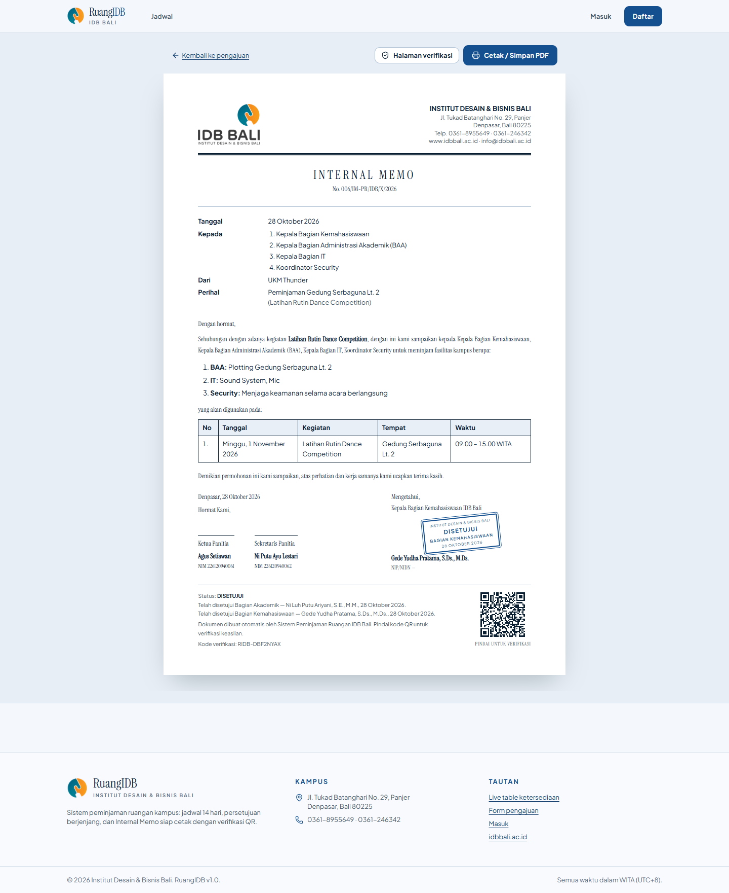

# RuangIDB

Sistem Peminjaman Ruangan Kampus **Institut Desain & Bisnis Bali**. Satu papan untuk
29 ruangan, jadwal 14 hari, persetujuan berjenjang, dan Internal Memo A4 bertanda QR.



| Live table 14 hari | Internal Memo |
|---|---|
|  |  |

Dokumen ini menjelaskan cara menjalankan, arsitektur, aturan bisnis, API, dan cara
memindahkan database ke PostgreSQL/Supabase.

---

## 1. Ringkasan

| | |
|---|---|
| Nama produk | RuangIDB |
| Institusi | Institut Desain & Bisnis Bali (IDB Bali) |
| Basis | PRD *Sistem Peminjaman Ruangan Kampus IDB Bali* v1.0 (22 Oktober 2026) |
| Platform | Web responsif (desktop, tablet, ponsel) |
| Bahasa | Bahasa Indonesia |
| Zona waktu | WITA (UTC+8) — seluruh tanggal/jam disimpan sebagai waktu kampus |

### Fitur utama

- **Live table 14 hari** — 29 ruangan, dua mode (daftar dan grid ruangan × tanggal),
  filter, pencarian, pembaruan otomatis tiap 15 detik. Aula otomatis berstatus
  **Ditolak** pada hari Minggu.
- **Inline edit Bagian Akademik** — ubah kondisi dan situasi ruangan langsung dari baris tabel,
  tandai ruangan ditolak, dan buka kembali.
- **Form pengajuan** dengan tiga pilihan peminjam (Dosen, Mahasiswa, Organisasi),
  22 organisasi mahasiswa, sesi jadwal berganda, permintaan fasilitas IT/Operasional/
  Security/BAA, lampiran, dan pratinjau jalur persetujuan. **Jenis peminjam terkunci
  sesuai akun yang masuk** (mahasiswa/dosen/ormawa); NIM + jurusan, kode dosen + prodi,
  atau organisasi terisi otomatis dari akun. Jam dipilih dalam format 12 jam
  (mis. **01.30 PM**) dengan batas selesai **08.00 PM**.
- **Galeri fasilitas kampus** di beranda dan halaman masuk, memakai foto resmi
  `idbbali.ac.id` (Gedung IDB, Lab IMAC, Lab Fashion, Creative Gallery, Lobby).
- **Draft & revisi** — simpan draft, buka kembali dengan data terisi, ubah, lalu kirim
  ulang; validasi jadwal dijalankan lagi saat dikirim.
- **Jalur persetujuan berbasis peminjam** — pengajuan organisasi: Bagian Akademik lalu Kemahasiswaan; mahasiswa/dosen: Bagian Akademik saja. Tidak ada approve otomatis.
- **Cek bentrok atomik** di dalam transaksi database; slot menunggu berstatus *Menunggu Approve*.
- **Hard limit kapasitas** — pengajuan dengan peserta melebihi kapasitas ruangan otomatis ditolak (validasi server + trigger database).
- **Internal Memo A4** siap cetak: kop resmi, nomor dokumen unik, tabel jadwal,
  daftar fasilitas per bagian, tanda tangan, **stempel Bagian Akademik** untuk
  mahasiswa/dosen, **stempel Kemahasiswaan di TTD Kabag** untuk ormawa, dan
  **QR verifikasi keaslian**.
- **RBAC** untuk Admin · Bagian Akademik, Kemahasiswaan, Mahasiswa, Dosen, Organisasi.
- **Dashboard admin** — admin dan Kemahasiswaan hanya melihat menu Jadwal dan Dashboard;
  menu Ajukan/Pengajuan Saya khusus pengaju.
- **Audit log**, verifikasi organisasi, laporan pemakaian, dan ekspor CSV.

---

## 2. Stack

| Lapisan | Pilihan |
|---|---|
| Frontend | Next.js 15 (App Router), React 19, TypeScript |
| Styling | Tailwind CSS v4 + token CSS semantik |
| Ikon | Lucide |
| Komponen | Primitif shadcn-style (CVA + Tailwind), modal `<dialog>` native |
| Backend | Next.js Route Handlers (Node runtime) |
| Database | SQLite via `node:sqlite` (bawaan Node 24) |
| QR | `qrcode` (SVG, dibuat di server) |
| Validasi | Zod |
| Autentikasi | Cookie sesi HMAC + kata sandi scrypt (`node:crypto`) |

Tidak ada dependensi native yang perlu dikompilasi. Database dibuat otomatis dan
di-seed saat pertama kali dibuka.

---

## 3. Menjalankan

Prasyarat: **Node.js 24+** (karena memakai `node:sqlite`). Tidak perlu PostgreSQL
untuk demo lokal.

```bash
npm install

# opsional: isi ulang database demo
npm run db:seed        # seed bila kosong
npm run db:reset       # hapus dan seed ulang

npm run dev            # http://localhost:3000
```

`.env.local` (sudah dibuat) berisi:

```dotenv
AUTH_SECRET=...        # HMAC untuk cookie sesi, ganti di produksi
APP_URL=http://localhost:3000   # dipakai QR verifikasi memo
```

Windows: jika PowerShell memblokir `npm.ps1`, jalankan `npm.cmd install` atau
`Set-ExecutionPolicy -Scope CurrentUser RemoteSigned`.

### Preview ke perangkat lain

Untuk membuka aplikasi dari HP/tablet di jaringan yang sama:

```bash
npm run start -- -H 0.0.0.0    # lalu buka http://<IP-LAN>:3000
```

Untuk link publik sementara (HTTPS), jalankan tunnel Cloudflare tanpa akun:

```bash
cloudflared tunnel --url http://localhost:3000
```

Lalu jalankan aplikasi dengan URL publik agar QR memo ikut benar:

```bash
APP_URL=https://nama-tunnel.trycloudflare.com COOKIE_SECURE=false npm run start
```

`COOKIE_SECURE=false` diperlukan bila preview juga diakses lewat HTTP LAN;
cookie sesi tetap `httpOnly` dan `SameSite=Lax`. Tunnel quick Cloudflare bersifat
sementara dan berhenti saat proses/mesin dimatikan.

### Deploy permanen

Agar link tetap hidup tanpa PC dan tanpa tunnel, deploy ke container host dengan
volume persisten. Panduan lengkap (Railway, Render, Fly.io, VPS) ada di
[`DEPLOY.md`](DEPLOY.md). Ringkasnya: set `AUTH_SECRET`, mount volume ke
`/app/data`, set `APP_URL`, lalu deploy Dockerfile yang sudah disediakan.

Perintah lain:

```bash
npm run typecheck      # tsc --noEmit
npm run build          # build produksi
npm run start          # jalankan hasil build
```

---

## 4. Akun demo

Kata sandi semua akun: **`RuangIDB#2026`**

| Peran | Email | Catatan |
|---|---|---|
| Bagian Akademik · BAA | `admin1@idbbali.ac.id` | akses penuh ruangan, approval, audit |
| Kemahasiswaan · Kemahasiswaan | `admin2@idbbali.ac.id` | approval tahap 2, verifikasi ormawa |
| Mahasiswa | `mahasiswa@idbbali.ac.id` | NIM 236120940018, DKV |
| Dosen | `dosen@idbbali.ac.id` | NIDN 0812345678, Arsitektur |
| Organisasi (BEM) | `bem@idbbali.ac.id` | organisasi terverifikasi |
| Organisasi (UKM Lontar) | `ukm.lontar@idbbali.ac.id` | akun **menunggu verifikasi** Kemahasiswaan |

Data seed mencakup 10 pengajuan (disetujui, menunggu, ditolak, revisi), penandaan slot ditolak,
override kondisi, notifikasi, dan audit log.

---

## 5. Peran & izin

| Peran | Hak akses |
|---|---|
| **Admin · Bagian Akademik** | data master ruangan, live table (kondisi/situasi/penandaan), approval tahap 1, pembatalan, pengguna, audit, laporan |
| **Kemahasiswaan** | lihat live table, approval tahap 2 pengajuan ormawa, verifikasi akun ormawa, laporan, cetak memo |
| **Mahasiswa** | lihat live table, ajukan, lacak, batalkan (≤ H-1), unduh memo |
| **Dosen** | sama dengan mahasiswa; pengajuan ditandai kegiatan akademik |
| **Organisasi** | sama, wajib memilih organisasi + Ketua & Sekretaris Panitia; pengajuan dua tahap setelah organisasi diverifikasi |

Pembatasan ditegakkan di tiga lapis: navigasi/antarmuka, server component
(`requireUser`/`requireAdmin`), dan route handler (cek peran + origin).

---

## 6. Ruangan, gedung & kelas

Ruangan dikelompokkan ke tiga pilihan gedung pada filter live table:

| Gedung | Isi |
|---|---|
| **Gedung IDB** | seluruh ruangan berkode A dan B, Aula, Inkubator Bisnis, Lab IMAC, Studio, Rooftop, Creative Gallery, Gedung B (Gear Inc) |
| **Gedung NMC** | seluruh ruangan berkode C (`C.1.1`–`C.3.3`) |
| **Gedung Serbaguna** | GS-1, GS-2, GS-3 |

**Kelas ruangan** kini hanya metadata ruangan (tidak menentukan jalur approval):
Kelas A (10): `A.1.2`, `A.2.3`, `B.1.3`, `C.1.3`, `C.2.1`, `C.2.2`, `C.2.3`,
`C.3.1`, `C.3.2`, `C.3.3`; Kelas B (5, Lab Komputer): `A.1.3`, `A.2.1`, `A.2.2`,
`C.1.1`, `C.1.2`; Kelas C (14): `A.1.1` Studio Pola, `A.1.4` Studio Foto,
`B.1.1` Lab IMAC, `B.1.2` Inkubator Bisnis, `B.1.4` Lab Fashion, `B.2.1` Ruang
Internasional, `B.2.2` Ruang Magister, AULA, ROOFTOP, GS-1, GS-2, GS-3,
GEDUNG-B (Gear Inc), dan GALLERY. Kelas A memakai batas pengajuan H-1, kelas B/C H-3.

> **Catatan 29 ruangan.** Daftar PRD menghasilkan 28 kode setelah duplikat `C.3.3`
> (diasumsikan `C.2.3`) dirapikan. Ruangan ke-29 adalah **Creative Gallery**, fasilitas
> resmi yang tercantum di situs IDB Bali. Ubah/hapus lewat menu **Dashboard → Ruangan**
> bila daftar final kampus berbeda.

Atribut per ruangan: kode, nama, gedung, lantai, kategori, kapasitas, kelas,
kondisi (`BAIK`, `PERLU_PERAWATAN`, `RUSAK`, `DITUTUP`), kebutuhan plotting Bagian Akademik,
status aktif, catatan, dan fasilitas tetap.

---

## 7. Alur & aturan bisnis

```
Mahasiswa/Dosen: ──► Menunggu Approve Bagian Akademik ──setuju──► Disetujui + memo (stempel Akademik)
Organisasi:      ──► Menunggu Approve Bagian Akademik ──setuju + cek ruangan──► Menunggu Approve Kemahasiswaan ──setuju──► Disetujui + memo (stempel Kemahasiswaan)
```

Tidak ada persetujuan otomatis oleh sistem. Semua pengajuan masuk antrean Bagian
Akademik; hanya pengajuan organisasi yang dilanjutkan ke Kemahasiswaan.

Status: `DRAFT`, `PENDING_ADMIN1`, `PENDING_ADMIN2`, `APPROVED`,
`REJECTED`, `REVISION`, `CANCELLED`, `COMPLETED`.

| Aturan | Implementasi |
|---|---|
| **BR-01** tidak boleh bentrok | validasi irisan `[start, end)` terhadap pengajuan Disetujui **dan** Menunggu Approve, diulang di dalam transaksi `BEGIN IMMEDIATE` sebelum insert |
| **BR-02** slot menunggu = Menunggu Approve | status `PENDING_*` ikut mengunci slot dan tampil kuning di papan |
| **BR-03** H-1 (A) / H-3 (B/C), maks. 14 hari | dicek per sesi; batas disimpan di tabel `settings` |
| **BR-04** pengingat > 2 hari kerja | badge “> 2 hari kerja” di antrean; email masuk `email_outbox` |
| **BR-05** penandaan ditolak oleh Bagian Akademik mengalahkan pengajuan | `room_blocks` + notifikasi ke pengaju terdampak |
| **BR-06** ruangan Rusak/Ditutup | tidak bisa diajukan; tampil Ditolak |
| **BR-07** ormawa harus terverifikasi | login ormawa belum aktif sampai Kemahasiswaan memverifikasi; pengajuan organisasi ditolak |
| **BR-08** jejak audit | setiap transisi menulis `audit_logs` (aktor, aksi, before/after) |
| **BR-09** jenis peminjam mengikuti akun | mahasiswa → `MAHASISWA`, dosen → `DOSEN`, ormawa → `ORGANISASI`; NIM/jurusan, kode dosen/prodi, dan organisasi terkunci dari akun; API menolak tipe/identitas yang tidak cocok |
| **BR-10** Aula tutup hari Minggu | Aula IDB Bali (`room_aula`) tidak dapat diajukan pada hari Minggu; validasi server menolak sesi, sel live table berstatus **Ditolak**, dan form menampilkan error serta menonaktifkan Kirim |

Aturan tambahan: jam operasional 07.00–20.00 WITA (**07.00 AM–08.00 PM**), maksimal 6 jam per sesi, peserta ≤
kapasitas, lampiran wajib untuk pengajuan organisasi, dan pernyataan tanggung jawab wajib.
**Batas akhir kegiatan adalah 08.00 PM (20.00 WITA)**; sesi yang selesai lebih dari itu
ditolak oleh validasi server.
**Kapasitas bersifat hard limit:** jumlah peserta yang melebihi kapasitas ruangan membuat
pengajuan otomatis ditolak — divalidasi di server, ditolak sebelum insert, dan dijaga
oleh trigger database `trg_bookings_capacity_*`.

---

## 8. Cek bentrok atomik

`lib/bookings.ts` → `createBooking()`:

1. Validasi awal (lead time, kapasitas, verifikasi, lampiran) untuk umpan balik cepat.
2. Masuk `withImmediateTransaction()` (`BEGIN IMMEDIATE`) — SQLite memegang write-lock
   sebelum membaca jadwal.
3. Pemeriksaan bentrok diulang **di dalam** transaksi, lalu baris `bookings`,
   `booking_sessions`, fasilitas, approval, notifikasi, dan audit ditulis.
4. `COMMIT` hanya bila semua lolos. Dua pengajuan serentak tidak dapat sama-sama lolos.

Lihat bagian 13 untuk padanan PostgreSQL (advisory lock + `EXCLUDE`).

---

## 9. Skema database

| Tabel | Isi |
|---|---|
| `organizations` | 22 ormawa, status verifikasi |
| `users` | akun + peran + NIM/NIDN + organisasi |
| `rooms` | data master 29 ruangan |
| `room_facilities` | fasilitas tetap per ruangan |
| `bookings` | pengajuan, status, nomor dokumen, kode verifikasi |
| `booking_sessions` | satu baris per sesi (tanggal, mulai, selesai) |
| `booking_facilities` | permintaan fasilitas per bagian |
| `attachments` | lampiran (path privat di `data/uploads`) |
| `approvals` | jejak keputusan AUTO/ADMIN1/ADMIN2 |
| `room_overrides` | kondisi/situasi per ruangan per tanggal |
| `room_blocks` | penandaan slot ditolak oleh Bagian Akademik |
| `notifications` | notifikasi dalam aplikasi |
| `email_outbox` | email simulasi (SMTP belum terpasang) |
| `audit_logs` | log audit append-only |
| `doc_counters` | nomor dokumen per tahun |
| `settings` | jendela 14 hari, lead time, jam operasional, durasi maksimum |
| `login_attempts` | pembatasan percobaan login |

Skema lengkap: `lib/schema.ts`.

---

## 10. API

Semua route memakai JSON, kecuali CSV, upload, dan lampiran. Mutasi memeriksa origin
(CSRF sederhana) dan sesi.

| Method | Endpoint | Akses | Fungsi |
|---|---|---|---|
| POST | `/api/auth/login` | publik | masuk, set cookie sesi |
| POST | `/api/auth/logout` | sesi | hapus cookie |
| POST | `/api/auth/register` | publik | daftar mahasiswa/dosen/ormawa |
| GET | `/api/availability?from&to` | publik | data papan (nama disamarkan untuk tamu) |
| POST | `/api/bookings/check` | sesi | cek slot + saran jam terdekat |
| POST | `/api/bookings` | sesi | buat pengajuan/draft (atomik) |
| POST | `/api/bookings/:id/decision` | Admin | setujui/tolak/revisi |
| POST | `/api/bookings/:id/cancel` | pemilik/Admin | batalkan |
| POST | `/api/bookings/:id/submit` | pemilik | kirim draft/revisi tanpa perubahan |
| PATCH | `/api/bookings/:id` | pemilik | ubah draft/revisi lalu kirim ulang |
| POST | `/api/uploads` | sesi | unggah PDF/JPG/PNG ≤ 5 MB |
| GET | `/api/attachments/:id` | pemilik/Admin | unduh lampiran privat |
| PUT | `/api/rooms/:id/state` | Bagian Akademik | inline edit kondisi/situasi |
| PATCH | `/api/rooms/:id` | Bagian Akademik | ubah data master |
| POST | `/api/rooms` | Bagian Akademik | tambah ruangan |
| POST | `/api/blocks` | Bagian Akademik | tandai ruangan ditolak |
| DELETE | `/api/blocks/:id` | Bagian Akademik | buka kembali ruangan |
| PATCH | `/api/users/:id` | Bagian Akademik | aktif/nonaktif akun |
| PATCH | `/api/organizations/:id` | Admin | verifikasi ormawa |
| PATCH | `/api/notifications` | sesi | tandai semua dibaca |
| GET | `/api/export` | Admin | ekspor CSV |
| GET | `/api/health` | publik | health check + jumlah data |

Halaman: `/`, `/jadwal`, `/login`, `/daftar`, `/ajukan`, `/pengajuan`,
`/pengajuan/[id]`, `/admin/*`, `/notifikasi`, `/memo/[kode]`, `/verify/[kode]`.

---

## 11. Internal Memo & QR

- Nomor dokumen dibuat saat pengajuan disetujui: `012/IM-PR/IDB/X/2026`
  (counter per tahun, aman dari tabrakan dengan data seed/import).
- Kode verifikasi acak: `RIDB-XXXXXXXX`, unik per memo.
- Halaman `/memo/[kode]` adalah lembar A4 dengan CSS cetak (`@page A4`, margin 14–16 mm),
  kop resmi, tabel jadwal, dan fasilitas per bagian.
- **Mahasiswa/dosen:** memo hanya memuat kolom tanda tangan pemohon dan **stempel
  “Disetujui Bagian Akademik”**; blok tanda tangan Kemahasiswaan tidak ditampilkan.
- **Organisasi:** format lengkap (Ketua + Sekretaris Panitia dan “Mengetahui” Kepala
  Bagian Kemahasiswaan) + **stempel “Disetujui Bagian Kemahasiswaan”** di area TTD Kabag,
  serta dua baris persetujuan (Akademik dan Kemahasiswaan) beserta tanggalnya.
- Tombol **Cetak / Simpan PDF** memakai dialog cetak browser (print-to-PDF). Header dan
  footer situs otomatis disembunyikan saat mencetak.
- QR mengarah ke `/verify/[kode]` yang menampilkan status, nomor, kegiatan, ruangan,
  jadwal, dan jejak persetujuan langsung dari database.

`APP_URL` menentukan host di dalam QR — set ke domain produksi sebelum go-live.

---

## 12. Waktu

- Tanggal disimpan `YYYY-MM-DD`, jam `HH:MM` 24 jam (waktu kampus) agar perbandingan
  jadwal tidak bergantung zona waktu server. **UI menampilkan dan memilih jam dalam
  format 12 jam** (`01.30 PM`, `08.00 PM`) melalui `components/ui/time-picker.tsx`;
  nilai 12 jam dikonversi kembali ke `HH:MM` saat dikirim.
- Timestamp audit/approval disimpan ISO UTC dan ditampilkan 12 jam dengan
  `Intl.DateTimeFormat(..., { timeZone: "Asia/Makassar", hour12: true })`.
- Tidak ada DST di Bali, sehingga aritmetika tanggal memakai UTC pada tengah malam.

---

## 13. Keamanan

- Kata sandi: scrypt (`node:crypto`) dengan salt acak; verifikasi timing-safe.
- Sesi: cookie `httpOnly`, `SameSite=Lax`, HMAC-SHA256, kedaluwarsa 8 jam.
- Login: maksimal 8 kegagalan per email dalam 15 menit (tabel `login_attempts`).
- Otorisasi: setiap halaman admin dan route mutasi memeriksa peran; keputusan approval
  juga memeriksa tahap dan status saat ini.
- CSRF: `Origin` harus sama dengan `Host` untuk semua mutasi.
- Upload: allowlist MIME, batas 5 MB, nama file disimpan acak, akses lampiran privat.
- SQL: semua query memakai prepared statement.
- XSS: React meng-escape output; konten halaman tidak pernah dieksekusi sebagai HTML.
- Log audit tidak menyediakan jalur edit/hapus dari aplikasi.

---

## 14. Struktur proyek

```
app/
  api/                     route handlers (auth, availability, bookings, rooms, ...)
  admin/                   panel Bagian Akademik & 2
  ajukan/                  form pengajuan
  jadwal/                  live table
  pengajuan/               riwayat + detail
  memo/[code]/             Internal Memo A4
  verify/[code]/           verifikasi QR publik
  layout.tsx, page.tsx, globals.css
components/
  availability/            papan daftar + grid, inline edit, penandaan
  booking/                 form, keputusan, pembatalan, submit
  admin/                   ruangan, pengguna, navigasi admin
  auth/                    login, registrasi
  memo/                    tombol cetak
  ui/                      primitif shadcn-style
lib/
  auth.ts, password.ts     sesi, RBAC, login
  bookings.ts              validasi + alur persetujuan + atomik
  data.ts                  query baca
  admin.ts                 mutasi ruangan/pengguna/ormawa
  availability.ts          derivasi situasi + warna
  seed.ts                  data demo
  schema.ts, db.ts         skema + koneksi/transaksi
  time.ts                  WITA, format, overlap
scripts/seed.ts            seed CLI
public/brand/              logo & foto kampus
DESIGN.md                  design brief + token
```

---

## 15. Migrasi ke PostgreSQL/Supabase

Skema sengaja portabel. Langkah yang disarankan:

1. Ganti `TEXT` id dengan `uuid` (atau pertahankan id aplikasi).
2. `INTEGER` boolean → `boolean`; `TEXT` tanggal → `date`; jam → `time`.
3. Buat constraint bentrok di level database:

   ```sql
   CREATE EXTENSION IF NOT EXISTS btree_gist;

   -- simpan status pada slot (denormalisasi dari bookings, dijaga trigger)
   ALTER TABLE booking_slots
     ADD CONSTRAINT booking_slots_no_overlap
     EXCLUDE USING gist (
       room_id WITH =,
       date WITH =,
       tsrange(date + start_time, date + end_time) WITH &&
     )
     WHERE (status IN ('PENDING_ADMIN1','PENDING_ADMIN2','APPROVED'));
   ```

4. Bungkus cek + insert dengan `SELECT pg_advisory_xact_lock(hashtext(room_id || date));`
   di dalam transaksi `SERIALIZABLE` sebagai lapisan kedua.
5. Ganti `lib/db.ts` dengan `pg`/Supabase client; pertahankan bentuk fungsi
   `queryAll/queryOne/execute/withImmediateTransaction`.
6. Untuk Supabase: aktifkan RLS, petakan peran aplikasi ke klaim JWT, dan gunakan
   Storage untuk lampiran. Ganti auth lokal dengan Supabase Auth bila diinginkan.

---

## 16. Batasan & langkah berikutnya

- **Email** disimulasikan ke tabel `email_outbox`; belum ada SMTP/Resend.
- **PDF** dihasilkan lewat print-to-PDF browser; belum ada endpoint PDF biner.
  (Layout A4, stempel, dan QR sudah final.)
- **SSO/email institusi** belum diwajibkan; registrasi menerima email apa pun.
- Pengajuan berulang, integrasi SIAKAD, dan tanda tangan digital belum termasuk MVP.
- Dashboard metrik masih sederhana (menunggu/disetujui/utilisasi/ruangan teratas).
- 29 ruangan mengasumsikan Creative Gallery sebagai ruangan ke-29 (lihat bagian 6).

---

## 17. Verifikasi yang sudah dilakukan

- `tsc --noEmit` dan `next build` bersih.
- Login lima peran; redirect sesuai peran; ormawa pending ditolak. Admin/Kemahasiswaan hanya melihat Jadwal + Dashboard.
- Pengajuan Dosen → Menunggu Approve Bagian Akademik → Disetujui + memo dengan **stempel Bagian Akademik**.
- Pengajuan Organisasi → Menunggu Approve Bagian Akademik (ceklis ruangan) → Menunggu Approve Kemahasiswaan → Disetujui + memo dengan **stempel Kemahasiswaan di TTD Kabag**.
- Draft → “Ubah data” (form terisi) → kirim ulang → masuk antrean Bagian Akademik (bukan auto).
- Cek bentrok menolak Aula 24 Okt 09.00–11.00 (bentrok + H-3 + lampiran).
- **Hard limit kapasitas:** 999 peserta pada ruang berkapasitas 40 → API menolak (422) dengan pesan otomatis ditolak, tombol Kirim nonaktif, dan trigger database menolak perubahan langsung.
- **Jenis peminjam mengikuti akun:** login mahasiswa → Mahasiswa (NIM + jurusan read-only), dosen → Tenaga Pendidik (kode dosen + prodi read-only), ormawa → Organisasi (organisasi terkunci). API menolak payload yang mengganti tipe/identitas (mis. mahasiswa mengirim `DOSEN`, NIM berbeda, atau ormawa memilih organisasi lain).
- **Aula hari Minggu:** sesi Aula pada Minggu (mis. 1 Nov 2026) ditolak server dengan pesan “Aula tidak dapat digunakan pada hari Minggu”, tombol Kirim nonaktif, dan sel live table berstatus Ditolak; tanggal Sabtu tetap dapat diajukan.
- **Batas jam selesai 08.00 PM:** sesi 02.00 PM–08.00 PM diterima; sesi sampai 08.30 PM ditolak oleh cek server dengan pesan “di luar jam operasional 07.00 AM – 08.00 PM WITA” dan tombol Kirim nonaktif.
- **Time picker 12 jam:** memilih 01.30 PM menghasilkan state 13:30 dan tampilan `01.30 PM` di ringkasan, tabel, memo, dan CSV.
- Inline edit kondisi C.3.2 → `RUSAK` → situasi langsung **Ditolak** dan persisten.
- QR `/verify/[kode]` menampilkan dokumen sah.
- Layout diperiksa pada 1440×900 dan 390×844 (daftar, grid, form, memo, admin).
- Kontras token diperiksa dengan gate WCAG: 14 pasangan teks/latar (termasuk keempat
  status) lolos AA; `accent-ink` pada `accent` 5,36:1 dan `brand` pada `base` 7,59:1.

---

## 18. Lisensi & kredit

Kode aplikasi: MIT. Aset logo, nama, dan alamat IDB Bali milik Institut Desain &
Bisnis Bali; dipakai untuk keperluan demo internal. Foto fasilitas di
`public/campus/` bersumber dari halaman resmi
[`idbbali.ac.id/fasilitas-kampus`](https://www.idbbali.ac.id/fasilitas-kampus/)
dan dipakai sebagai materi demo kampus. Mark resolusi tinggi hasil
rasterisasi `IMAGE 3.pdf` tersedia di `public/brand/idb-mark-print.png`. Font
**Instrument Serif** dan **Plus Jakarta Sans** berlisensi SIL Open Font License.
Ikon dari **Lucide**.
